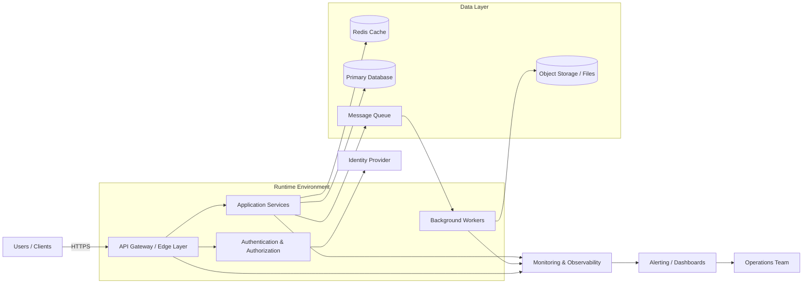

# Architecture Overview

This document provides a high-level view of the system architecture and the main components involved in request processing, data flow, and operations.

## Components

- API Gateway / Edge Layer: Handles incoming requests, routing, TLS, and load balancing.
- Authentication & Authorization: Validates identity and enforces access policies.
- Application Services: Business logic for processing user requests and orchestration.
- Redis Cache: Reduces latency for frequently accessed data.
- Primary Database: Stores transactional and application data.
- Message Queue: Decouples asynchronous tasks and background processing.
- Background Workers: Execute long-running jobs and event-driven workflows.
- Object Storage: Stores unstructured data such as files or documents.
- Monitoring & Observability: Collects logs, metrics, and traces for health and reliability.
- Alerting / Dashboards: Surfaces incidents and operational insights to the team.

## Notes

This diagram is intentionally architecture-level and can be adapted to match a specific application stack, cloud environment, or deployment topology.
